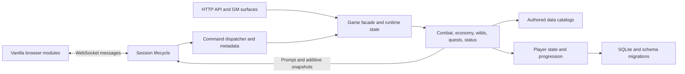

# Architecture and ownership

This is a map of the existing module seams, not a proposal to move files.
For the exact current imports and directory edges, run
`npm run audit:modules -- --json`. The audit reads source without booting a world.
It reports cycles for review; existing cycles are not automatically errors.

## Runtime flow

[The entry point](../server/index.js) resolves launch settings and port ownership
before loading the world and database. [Session handling](../server/session.js)
owns authentication, character ownership, input limits and wire routing.
[The dispatcher](../server/commands/index.js) expands aliases and chains, routes
movement and invokes domain command handlers. [Command metadata](../server/commands/metadata.js)
declares roundtime, aliases, passive panel safety and mutation domains.

[Game](../server/game.js) holds the world and delegates domain behavior.
[Player](../server/player.js) owns character progression and inventory state.
[The database module](../server/db.js) opens persistence; importing it is an
action, so tests must configure their owned database before any transitive import
can reach it. [Schema migrations](../server/schema.js) apply versioned upgrades.
See [recovery](RECOVERY.md) for snapshots and restoration.

## Read-only player discovery

| Capability | Source of truth | Presentation |
|---|---|---|
| Commands and contextual help | [Shared command catalog](../public/js/command-reference.js) plus registry metadata | Commands dock and `help <topic>` |
| Work orders | [Order snapshot](../server/work-order.js) and shared crafting policy | `orders`, `route order`, Crafting dock |
| Recipe planning | Authored crafting catalogs and production gates | [Recipe reference](../server/recipe-reference.js), `recipes` |
| Equipped gear | Instance metadata and [equipment policy](../server/equipment-policy.js) | [Equipment reference](../server/equipment-reference.js), `equipment`, Inventory dock |
| Spell planning | Guild curricula, [spell policy](../server/spell-policy.js) and slot helpers | [Spell reference](../server/spell-reference.js), `spellbook`, tabbed Spells dock |
| Advancement | [Circle tables](../data/guilds.js) | [Progression plan](../server/progression.js), `progress`, Progress dock |
| Lesson planning | [Shared training policy](../server/training-policy.js), guild curricula and authored trainers | [Training reference](../server/training-reference.js), `training`, Training tab |
| Active quest objectives | [Quest snapshot](../server/quest-objectives.js) | [Quest domain](../server/quests.js), `journal`, live Journal |
| Hunting and services | Authored rooms, creatures, NPCs, items and guild catalogs | [World reference](../server/world-reference.js), `where`, `route` |

Passive panel requests invoke only metadata-approved handlers directly. They
do not expand player aliases or command chains and do not capture unrelated
story messages. The live Journal receives additive quest snapshots; old
descriptions remain supported. Preparing a command preserves an existing draft
and does not execute it. Spectator controls remain read-only.

## Verification and evidence

| Layer | Main check | Scope |
|---|---|---|
| Source syntax | `npm run verify` | JS/MJS syntax without loading modules |
| Domain behavior | `npm test` | Owned temporary databases and process fixtures |
| Command contracts | `npm run audit:commands` | Curated guide, static registry keys, metadata aliases and local routes |
| Content references | `npm run audit:data` | Catalog shapes, relationships and world navigation |
| Module references | `npm run audit:modules` | Static relative imports, reexports and literal dynamic imports |
| Project entry points | `npm run check:project` | Active docs, local fragments and explicit npm Node targets |
| Wire repeatability | `node scripts/verify-corpus.mjs` | Disposable capture/replay worlds |
| Browser behavior | `npm run regression:ego` | Supported Ego browser and an owned world |
| Progression balance | Bounded simulator cohorts | Saved matched manifests, requirements, completion and failure evidence |

The import audit is lexical rather than a full JavaScript parser. It excludes
artifact/dependency trees, does not execute modules, and reports variable dynamic
imports as unresolved. External package resolution and runtime initialization
remain the job of other checks. The JSON directory-edge summary shows current
cross-layer imports so contributors can review a seam before restructuring it.

Opt-in verification receipts use [the receipt helper](../scripts/lib/verification-receipt.mjs)
for atomic JSON output, check timings and before/after source identity. Fingerprints
cover the stated authored-source scope and do not replace simulator evidence or
prove external-service behavior.

## Parallel work

Assign file ownership before editing. Inspect status and mtimes, integrate at
the Game/domain/client seams, and stage only owned changes. Shared files need
small coordinated patches. Preserve historical reports and simulator evidence;
use [the project guide](README.md) to find current workflows and dated receipts.
